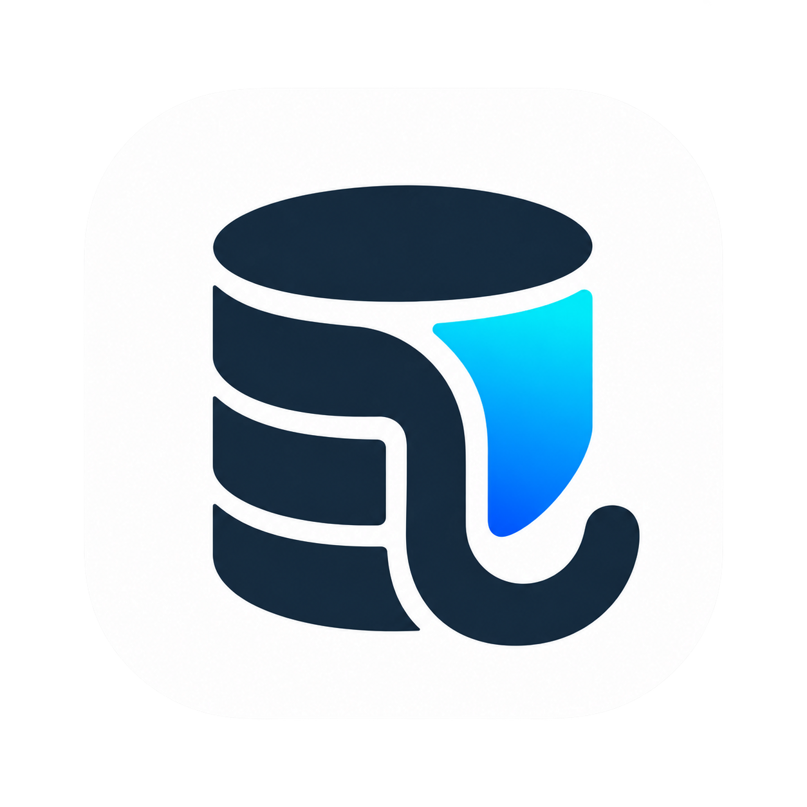
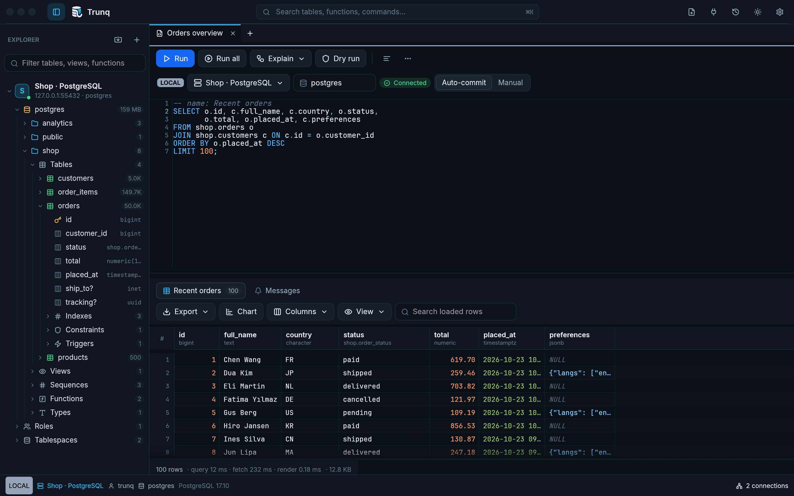

<p align="center">
  
</p>

<h1 align="center">Trunq</h1>

<p align="center"><b>The fast, native PostgreSQL client that keeps you out of incidents.</b><br>
Written in Rust, with a native GPU-rendered interface, paged results, blocking-session diagnostics
and warnings before risky schema changes.</p>

<p align="center">
  <a href="https://github.com/IssamElNass/Trunq/actions/workflows/ci.yml"></a>
  <a href="../../releases/latest"></a>
  <a href="LICENSE"></a>
  
  
</p>

<p align="center"></p>

---

## Start here

[Download](#download) · [First steps](#first-steps) · [Documentation](docs/README.md) · [Contributing](CONTRIBUTING.md)

## Why Trunq

Trunq combines a native Rust interface, paged PostgreSQL results and database diagnostics. It keeps database work off the UI thread and brings query editing, safe row changes, imports and exports into one client.

Performance depends on your query, server, network and hardware. See the [measured workloads](docs/performance.md) and [validation record](docs/validation.md) for evidence and limits.

## Download

Grab the latest build from the [**Releases page**](https://github.com/IssamElNass/Trunq/releases/latest):

| Platform | File |
|---|---|
| macOS 11+ (Apple Silicon and Intel) | `Trunq-<version>-macos-universal.dmg`: open it and drag **Trunq** to Applications |
| Windows 10/11 (x64) | `Trunq-<version>-windows-x86_64.zip`: unzip and run `Trunq.exe` |
| Debian / Ubuntu (x64) | `trunq_<version>_amd64.deb`: `sudo apt install ./trunq_<version>_amd64.deb` |
| Other Linux (x64) | `trunq-<version>-linux-x86_64.tar.gz`: unpack and run `./trunq` |

Every release lists SHA-256 checksums in `SHA256SUMS.txt`. Prefer to build it yourself? See [Install from source](docs/install.md#build-from-source).

Development snapshots are documented under [nightly builds](docs/install.md#nightly-builds).

## Features

- **SQL editor:** statement-aware Run, completion, bound parameters, formatting, snippets and query history.
- **Results:** paged server cursors, virtualised grid, search, filters, sorting, pinned comparisons and charts.
- **Data:** inline row editing with SQL preview, CSV import and five export formats with explicit row scopes.
- **Diagnostics:** blocking sessions, live query progress, EXPLAIN plans, database health and migration warnings.
- **Connections:** verified TLS/client certificates, SSH tunnels, Microsoft Entra ID, Azure service principals and cloud-neutral token helpers for AWS/Google/custom brokers.
- **Administration:** searchable extension manager with version/schema/dependency choices, pg_cron templates and audit/security inspections.
- **Navigation:** command palette, object tree, table structure and ER diagrams.

See the [feature reference and screenshots](docs/features.md), or follow the [user guide](docs/usage.md).

<p></p>

For production, use verified TLS, least-privilege roles and pinned SSH keys. This update requires re-entering older saved credentials and changes native SSH key compatibility; read the [upgrade guidance](docs/production.md#upgrade-and-credential-changes).

## Fast by design

Only visible grid cells are rendered. Results arrive in pages and live in compact buffers. Exporting an entire result streams to disk instead of retaining every row. [Performance details and reproducible checks](docs/performance.md).

## First steps

1. Click **New connection** (the plug icon in the top bar).
2. Paste a URL such as `postgres://analyst@db.example.com:5432/app?sslmode=verify-full` and press **Apply**,
   or fill in host, port, database and user.
3. Pick an **environment** (production turns red everywhere), press **Test connection**, then **Save**.
4. The connection appears in the sidebar. Expand it to browse databases, schemas, tables, views, functions and types.
   Double-click a table to open its data and right-click anything for more actions.
5. Press **⌘T** (Ctrl+T on Windows and Linux) for a SQL editor and **⌘⏎** to run the statement under the cursor.

Passwords are saved in your operating system keychain. Trunq also understands `~/.pgpass` and Unix sockets
(enter the socket directory, for example `/tmp`, as host).

## Documentation

| Task | Guide |
|---|---|
| Install a release or build from source | [Installation](docs/install.md) |
| Query, edit, import and export | [Using Trunq](docs/usage.md) · [Practical workflows](docs/workflows.md) |
| Configure TLS, pgpass, SSH and Azure | [Connections](docs/connections.md) · [Cloud authentication](docs/cloud-authentication.md) |
| Enable extensions, schedules and auditing | [Extension manager](docs/extensions.md) · [Administration](docs/administration.md) |
| Prepare production access or review security changes | [Production guide](docs/production.md) · [Security review](docs/security-review.md) |
| Change settings or back up a workspace | [Settings and backups](docs/settings.md) |
| Diagnose an error | [Troubleshooting](docs/troubleshooting.md) |
| Browse features and screenshots | [Feature reference](docs/features.md) |
| Develop, test and release | [Developer guide](docs/development.md) |
| See every documentation page | [Documentation index](docs/README.md) |

## Docker and Docker Hub

```sh
docker compose up --build -d
```

Open [the local desktop](http://localhost:8080/vnc.html?autoconnect=true&resize=scale). The supplied Compose file binds to loopback and persists settings in a named volume. The [Docker guide](docs/docker.md) explains database connections, files, authentication considerations and image publishing.

## Install from source

Requires **Rust 1.95+**. See [complete platform instructions](docs/install.md#build-from-source).

### macOS

Install the Xcode command line tools, clone the repository and run `./scripts/bundle-macos.sh --install`.

### Linux

On Debian/Ubuntu, install `build-essential pkg-config libssl-dev libxkbcommon-dev libwayland-dev`, then run `cargo build --release --locked`. See [Linux installation](docs/install.md#linux) for the full commands.

### Windows

Install Rust with the MSVC toolchain, Visual Studio C++ Build Tools and a Windows SDK, then run `cargo build --release --locked`. See [Windows installation](docs/install.md#windows).

## SSH tunnels

Enable **SSH tunnel** in the connection dialog. The database host is resolved from the SSH server. [Authentication and host-key checks](docs/usage.md#ssh-tunnels).

## Azure Database for PostgreSQL (Microsoft Entra ID)

Choose **Microsoft Entra ID** authentication and the matching Azure cloud. Browser, device-code, Azure CLI and service-principal sign-in are supported. Token commands add AWS RDS IAM, Google Cloud SQL IAM and custom brokers; PEM CA/client certificates are configurable. [Cloud-neutral setup](docs/cloud-authentication.md).

Right-click a database → **Manage extensions…** to search, choose a version/schema and enable or update extensions. [Extension quick start](docs/extensions.md). **Database tools** adds pg_cron job templates, audit/security inspections and replication/foreign-server inventories. [Administration guide and current limits](docs/administration.md).

## Keyboard shortcuts

On Windows and Linux use **Ctrl** instead of **⌘**.

| Shortcut | Action |
|---|---|
| ⌘⏎ | Smart Run: the selection, or the statement under the cursor |
| ⇧⌘⏎ | Run the whole script |
| ⌥⌘⏎ | Dry run (INSERT, UPDATE, DELETE, always rolled back) |
| ⌘E / ⇧⌘E | Explain / Explain Analyze |
| Esc | Cancel the running query |
| ⇧⌘F | Format SQL |
| ⌘/ | Toggle line comment |
| ⌘D | Duplicate line |
| Tab / ⇧Tab | Indent / outdent |
| ⌃Space | Show completions |
| ⌘S | Save the SQL file |
| ⌘K or ⌘P | Command palette |
| ⌘T / ⌘W | New tab / close tab |
| ⌃Tab / ⌃⇧Tab | Next / previous tab |
| ⌘B | Toggle the sidebar |
| ⌘F (in a grid) | Column finder |
| ⌘A, ⌘C, ⇧⌘C | Grid: select all, copy, copy with headers |
| Enter, F2 or double-click | Grid: edit a cell (table view) or open the value / JSON tree |
| ⌘-click | Follow a foreign key |
| ← / → | Card view: previous / next row |

## Where Trunq stores data

Settings, connections, tabs, snippets and history are stored locally. Passwords and tokens use the operating system keychain. `TRUNQ_CONFIG_DIR` selects an isolated workspace. [Paths and reset instructions](docs/usage.md#where-trunq-stores-data).

## Try it with the sample database

[Sample database setup](docs/usage.md#try-it-with-the-sample-database) creates customers, orders and one million analytics events. Use a disposable database: the script recreates its sample schemas.

## Troubleshooting

[Find fixes for authentication, Azure, SSH, graphics and keychain issues](docs/usage.md#troubleshooting).

## Benchmarks and PostgreSQL research

[Performance measurements](docs/performance.md) · [Validation record](docs/validation.md) · [PostgreSQL research notes](docs/postgresql-research.md).

## Development and releases

See [CONTRIBUTING.md](CONTRIBUTING.md) for guidelines and [the developer guide](docs/development.md) for code layout, tests, scripted UI checks and releases.

```sh
cargo fmt --all --check
cargo test --locked --all-targets
cargo clippy --locked --all-targets -- -D warnings
```

Database tests need `TRUNQ_TEST_DATABASE_URL`; see [integration-test setup](docs/development.md#postgresql-integration-tests).

## License

[MIT](LICENSE). Fonts: Inter and JetBrains Mono (SIL Open Font License). Icons: Lucide (ISC). Their licenses are in `assets/fonts/`.
