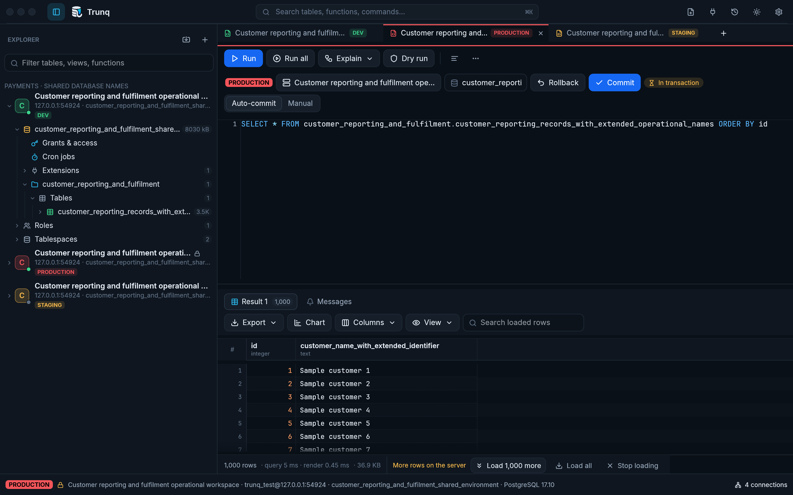

# Connections, TLS and authentication

[Documentation](README.md) · [First connection](usage.md#first-steps) · [Troubleshooting](troubleshooting.md)

## Choose and identify the connection

Create a profile with **New connection** and use **Test connection** before saving it. Give similar servers distinct names, groups and environment labels. The profile, user and database appear in the status bar; a Production label adds a red indicator. Labels and colours describe a connection; they do not change database privileges.

Use a separate saved profile for each environment, even when the database names match. Set **Environment** in the connection dialog and optionally use **Group** for the application or team. The sidebar and tab strip always show the environment badge; **UNSET** means no environment was chosen. Production badges remain red even with a custom profile colour. Hover an abbreviated connection or object name to read the full text.

Each query tab has its own database session. The object browser and other tabs can therefore be connected while one tab has failed. Changing a saved profile applies to new sessions; existing sessions keep their connection. Reconnect affected tabs after changing the host, authentication, TLS or timeout settings.



These profiles all target one disposable local fixture. Their environment labels demonstrate the display; they do not identify actual production infrastructure. [Light-theme view](screenshots/connection-environments-light.png) · [Compact window](screenshots/connection-environments-compact.png).

## Connection URL support

Both `postgres://` and `postgresql://` URLs can populate the connection form:

```text
postgresql://analyst@db.example.com:5432/reporting?sslmode=verify-full
postgresql://analyst@[::1]:5432/reporting?sslmode=prefer
```

The importer reads the user, password, host, port, database and `sslmode`. Percent-encode reserved characters in credentials, for example `%40` for `@` and `%3A` for `:`. IPv6 literals need brackets.

Other URL query parameters are not imported. Set SSH, read-only mode and timeouts in the form instead; a URL containing options such as `connect_timeout` does not apply them automatically. Review the populated fields after **Apply**. Importing a different host/port/user without a password clears the previous endpoint’s password; supply the intended credential before testing/saving.

## What each TLS mode checks

The default is `prefer`. These are the five modes exposed by Trunq:

| Mode | Encryption | Certificate trust | Database hostname |
|---|---|---|---|
| `disable` | No PostgreSQL TLS | Not checked | Not checked |
| `prefer` | TLS when accepted; plaintext if the server declines TLS | Not checked | Not checked |
| `require` | Required | Not checked | Not checked |
| `verify-ca` | Required | Checked against platform roots plus a configured CA bundle | Not checked |
| `verify-full` | Required | Checked against platform roots plus a configured CA bundle | Checked |

Use `verify-full` when you need to verify the server's identity. `require` encrypts the connection but accepts an untrusted or mismatched certificate. A TLS handshake error is still an error in `prefer`; its plaintext fallback concerns a server that declines TLS negotiation.

For a private/provider certificate authority, set **Advanced → Root CA bundle** to an absolute PEM file path, or arrange trust in the platform store. Client certificate/key fields support certificate authentication; see [formats and cloud examples](cloud-authentication.md#client-certificate-authentication). These files require TCP with at least `require`; select `verify-full` to check trust and hostname. A hostname mismatch usually means the database Host differs from a name in the server certificate.

TLS negotiation also applies to the PostgreSQL connection inside an SSH tunnel. Trunq verifies the database hostname from the Host field, rather than the bastion hostname. SSH host-key verification is a separate check.

On Unix, an absolute socket directory such as `/var/run/postgresql` in Host selects a local Unix socket. The port chooses the `.s.PGSQL.<port>` socket file. This local socket path does not negotiate PostgreSQL TLS; access depends on local socket permissions and PostgreSQL authentication rules.

## Password sources and pgpass

For password authentication, Trunq uses the first available value in this order:

1. A password supplied for the current session.
2. The profile's OS keychain entry, when **Save in keychain** is enabled.
3. The first matching password-file entry.

The password file is `~/.pgpass`, or the path set by `PGPASSFILE`. Its format is:

```text
# host:port:database:user:password
db.example.com:5432:reporting:analyst:replace-with-your-password
```

The first four fields match the configured connection values; `*` matches any value. Put specific entries before broad wildcard entries. Escape a literal colon as `\:` and a literal backslash as `\\`. For a Unix socket, match the directory entered as Host. On Windows you can set `PGPASSFILE` explicitly instead of relying on another client's password-file location.

The password file itself contains plaintext credentials. Unix files with group/other permission bits are ignored; use `chmod 600 ~/.pgpass`. Windows access follows filesystem ACLs. Turning off **Save in keychain** still allows a password-file fallback. A password typed for a session is remembered in the running app; restarting the app clears that in-memory value.

## Advanced profile settings

| Setting | Default | Effect |
|---|---|---|
| Read-only connection | Off | Sets PostgreSQL `default_transaction_read_only=on` for new sessions |
| Statement timeout | `0` seconds | A positive value sets `statement_timeout`; zero adds no client-specified limit, although server policy can still impose one |
| Connect timeout | `10` seconds | Bounds opening the transport, including SSH and TLS negotiation; authentication has an additional 5 seconds. Credential acquisition has its own timeout |
| Show system schemas | Off | Includes `pg_catalog` and `information_schema` in browsing |
| Only show the default database | Off | Limits the browser listing to the profile's configured database |

Read-only mode is a session default, not a replacement for a database role with restricted privileges. Hiding databases or system schemas only changes navigation. Settings on a saved profile apply when a new session is opened.

Background object-browser sessions add their own guards: a 5-second lock timeout, a 60-second statement timeout and a 60-second idle-in-transaction timeout. A metadata request can therefore time out while a query tab remains connected.

## SSH connection checklist

Follow [the SSH setup steps](usage.md#ssh-tunnels). Keep these two endpoints distinct:

| Field | Endpoint |
|---|---|
| SSH host, port, user | The bastion or jump host you can reach from the computer running Trunq |
| Database Host, Port | PostgreSQL as reached from that SSH server |

Agent, private-key-file and password authentication are supported. Key files may need a passphrase. Trunq checks both `~/.ssh/known_hosts` and the workspace's `known_hosts`; a changed key in either file is refused. Previously unknown keys are trusted and recorded only when **Trust previously unknown host keys on first use** is enabled (the compatibility default). For production, turn it off and provision independently verified raw host keys. Read/parse errors, revoked matching keys and changes across key algorithms fail closed. Host certificates and OpenSSH CA/wildcard policy are not supported; use exact or hashed raw-key entries. Native SSH supports Ed25519/ECDSA; RSA is excluded because of an unresolved dependency advisory.

For a changed key, compare the reported fingerprint with a trusted administrator or server record before updating the matching old entry. Moving the workspace file does not move your private keys or configure a new SSH agent. Connections using the same SSH configuration share the SSH session, while each database tab still has its own PostgreSQL session.

## Microsoft Entra ID session behaviour

See [Azure setup](usage.md#azure-database-for-postgresql-microsoft-entra-id) for the cloud and sign-in choices. Interactive/application tokens are cached separately for each configured sign-in identity while they have more than five minutes of validity. CLI mode asks the CLI at every new connection to respect external account changes. Before a new database connection, Trunq refreshes or signs in again as necessary. This does not replace the authentication of an already-open database session.

Browser and device-code flows can store a refresh token in the OS keychain. Azure CLI mode obtains a token from your existing CLI login. Tenant policy determines when another interactive sign-in is required; refresh-token use does not promise a fixed sign-in lifetime. The connection dialog's **Sign out** clears the cached token and stored refresh token for that sign-in configuration; it does not terminate existing database sessions or sign the Azure CLI out.

The database User field must identify an Entra principal or role configured on the PostgreSQL server. Leave it empty only when the signed-in account should supply it. For China or US Government, select the matching cloud and CLI cloud configuration. Azure profiles enforce at least `require`; select `verify-full` when certificate and hostname validation are required.

## Other providers and application identities

See [cloud-neutral authentication](cloud-authentication.md) for Azure service principals, managed identity/certificate/federation via CLI, AWS RDS IAM, Google Cloud SQL IAM, arbitrary token commands and client certificates. Authentication helpers run on connection workers, with bounded output/timeouts. They do not run on the UI thread.

## Connection count and disconnects

Click the connection count in the status bar to inspect purpose, PID and age, or close a connection. Each session sets an `application_name` such as `Trunq: Query 3`, making it identifiable in `pg_stat_activity`.

Idle query sessions disconnect after 15 minutes only when no query, transaction or fetchable result remains. Running the tab again reconnects it. Closing a tab closes its session and rolls back any uncommitted transaction. Save query text separately when needed; reconnecting does not recover temporary tables or session-local settings from a lost connection.

## Credential migration and target edits

Saved secrets are scoped by profile ID and a target fingerprint. Changing a database endpoint, default database, authentication or enabled bastion prevents forwarding the previous password; SSH changes invalidate the corresponding SSH secret. Labels/colours do not change the target. Re-enter older profile-ID-only saved database and SSH credentials once after this upgrade. Open sessions keep their original identity until disconnected. See [upgrade and cleanup details](production.md#upgrade-and-credential-changes).


This real dialog uses illustrative example endpoints; no example SSH connection was attempted.
