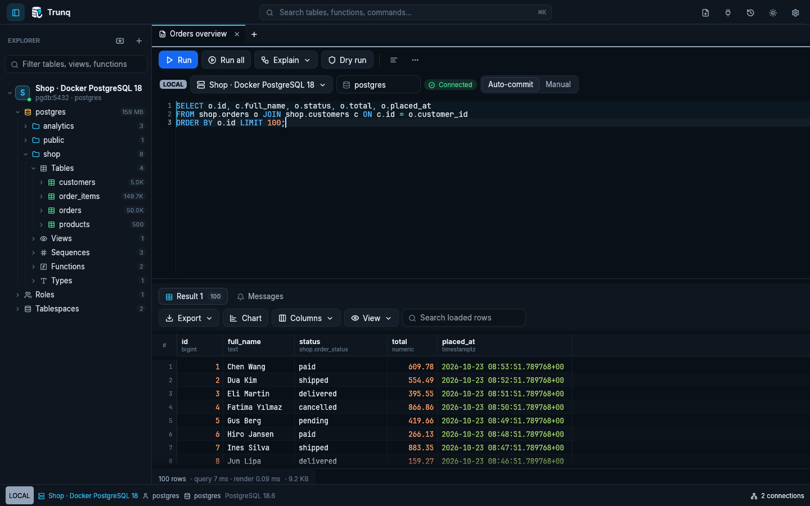

# Docker desktop and Docker Hub

Trunq is a native GUI application. The default image runs that same binary in Xvfb with a noVNC desktop so you can use it in a browser. This adds software rendering and desktop streaming overhead; use a native release for maximum interactive performance.

## Build and run

```sh
docker compose up --build -d
```

Open [the local desktop](http://localhost:8080/vnc.html?autoconnect=true&resize=scale). The fixed virtual screen scales to your browser window. Configuration and history persist in the `trunq-data` volume. Connections to a PostgreSQL service in another Compose stack use its service hostname on a shared network. To connect to the host, use `host.docker.internal`, not `localhost`.



The desktop has no built-in authentication. The supplied Compose file publishes HTTP only on `127.0.0.1`. For remote use, keep that binding and tunnel it with SSH (`ssh -L 8080:127.0.0.1:8080 server`), or configure an authenticated HTTPS reverse proxy. Container keychain services are not configured; leave **Save in keychain** off and supply the password per session or mount a protected `.pgpass` file.

```sh
docker compose logs -f trunq
docker compose down             # keeps the saved workspace
```

File dialogs use the included Zenity fallback when no desktop portal is available. Import/export files can live in the persistent `/data` directory. Copy them between the host and desktop with Compose:

```sh
docker compose cp ./input.csv trunq:/data/input.csv
docker compose cp trunq:/data/export.csv ./export.csv
```

The container runs as UID 10001, exposes only HTTP port 8080, and stops if the client or a desktop service exits. A health check verifies the noVNC HTTP endpoint. `TRUNQ_SCREEN=1920x1080x24` changes the virtual screen. The optional `native` build target omits the browser desktop for users configuring their own X11/Wayland display and GPU access:

```sh
docker build --target native -t trunq:native .
```

## Publish manually

Replace `YOUR_NAMESPACE` with your Docker Hub account or organization. Check out the stable release tag you are publishing (for example, `v0.1.0`) before building its version tag and `latest`:

```sh
docker login
docker buildx create --name trunq-builder --use  # once; or use your existing builder
docker buildx build --platform linux/amd64,linux/arm64 \
  -t YOUR_NAMESPACE/trunq:0.1.0 -t YOUR_NAMESPACE/trunq:latest --push .
```

Emulation is required to build a foreign architecture on a single machine. The GitHub workflow configures QEMU automatically. Manual `--push` publishes immediately; run your local image and check the desktop first.

For a development image, build from `main` and use `YOUR_NAMESPACE/trunq:dev` instead of the release tags above.

## Publish with GitHub Actions

[The Docker workflow](../.github/workflows/docker.yml) builds and smoke-tests a desktop image on pull requests, pushes to `main`, version tags and manual runs. It verifies the HTTP endpoint and that the client process remains alive. Publishing depends on that test.

Set repository **Settings → Secrets and variables → Actions**:

| Type | Name | Value |
|---|---|---|
| Variable | `DOCKERHUB_USERNAME` | Docker Hub account / namespace |
| Secret | `DOCKERHUB_TOKEN` | Access token with push permission to that repository |

Successful workflow runs for pushes to `main` publish `dev` and a `sha-<commit>` tag. To publish the current `main` without a new commit, choose **Actions → Docker → Run workflow**, select `main`, and enable **publish**. Leave **publish** disabled to run the smoke test only.

Docker image tags identify separate channels:

| Tag | Contents |
|---|---|
| `latest` | The most recently published stable release |
| `0.1.0` | A specific release, built from Git tag `v0.1.0` |
| `dev` | The newest successfully published development build of `main` |
| `sha-<commit>` | An image identified by its source commit |

`latest` is a mutable Docker tag. The workflow updates it when publishing a stable version tag; it is independent of GitHub's latest-release designation. Nightly desktop downloads are separate scheduled snapshots of the development branch.

Version tags such as `v0.1.0` publish version and major/minor image tags plus a commit tag. Stable version tags also update `latest`; prereleases and branch builds leave it unchanged. Manual runs follow the selected ref: `main` updates `dev`, a stable version tag updates the release tags, and other branches publish only a commit tag. Without the namespace, the publish job is skipped. Both amd64 and arm64 are built for publication; the pre-publication runtime smoke test currently runs on amd64.

No image has been pushed as part of the local implementation. A Docker Hub namespace and token must be configured before publication.
