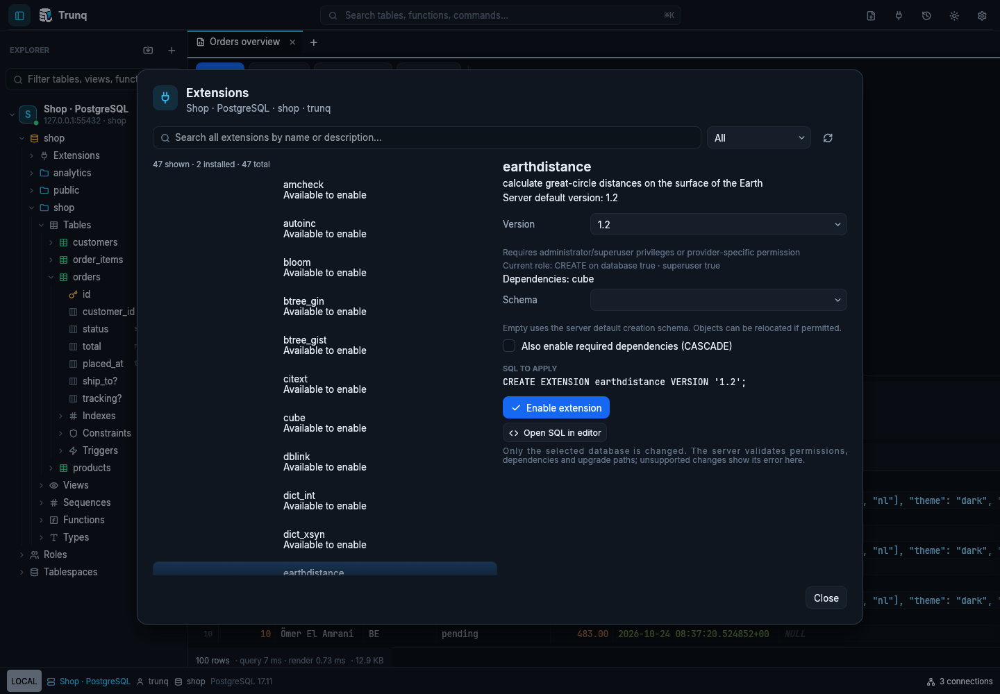
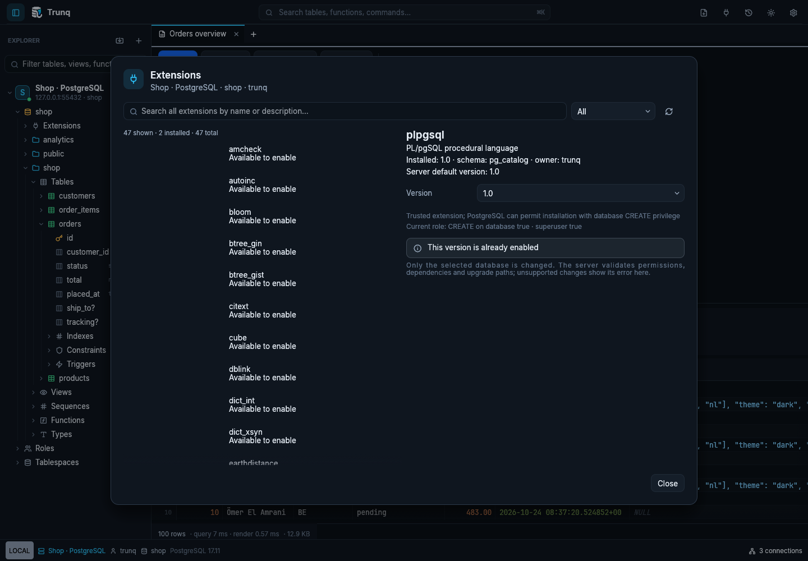

# Enable PostgreSQL extensions

[Documentation](README.md) · [Provider setup, pg_cron and auditing](administration.md)

## Find and enable an extension

1. **Right-click the target database → Manage extensions…** You can also double-click/right-click the **Extensions** tree group, search the command palette for **Manage extensions**, or use an installed extension's context menu.
2. Search by extension name or description. **All**, **Not installed** and **Installed** filter the server's inventory. The list is virtualized, so large catalogs remain navigable.
3. Select an extension. The details show its description, installed/default version, owner/schema, dependencies and privilege requirements.
4. Keep the server's default version, or choose another version it offers. For installation, choose an existing writable schema or leave the schema blank for the server's default. Extensions with a fixed schema use their required schema.
5. Review the displayed SQL, then click **Enable extension**. The server applies that change to this database; the manager and object browser refresh after success.

The list comes from `pg_available_extensions` and `pg_available_extension_versions`, combined with installed extensions. It is not a fixed Trunq allowlist. Installed extensions remain visible even if their server package is no longer available. Trunq does not guess the newest version from version-string ordering: the recommended selection is the server's `default_version`.

A normal PostgreSQL role can install a trusted extension when it has the required database/schema privileges. For other extensions, administrator or provider-specific permission may be needed. The dialog shows the role's visible capabilities; PostgreSQL makes the final permission decision. A denied change displays the server's error and leaves the manager usable for another attempt. Read-only connections and recovery databases disable changes.

Captured against disposable PostgreSQL 17 sample data. The visible inventory depends on the server packages and permissions; opening it does not change the database.

## Dependencies and upgrades

When a version declares dependencies, the manager lists them. **Also enable required dependencies (CASCADE)** is off by default. Select it when you want PostgreSQL to install missing extension dependencies as part of the operation; the SQL preview includes `CASCADE`. Otherwise enable the dependencies separately first. Upgrades do not add CASCADE automatically.

For an installed extension, choose a different offered version and use **Update to selected version**. The preview uses an explicit target version. Check the extension's upgrade instructions and backups first: PostgreSQL must have an update path from the installed version to the selected target. An offered version is not a guarantee that every installation can upgrade or downgrade to it. The already-installed version has no apply button.

The manager uses a dedicated connection. It does not commit or roll back a query tab's pending transaction. Closing the manager releases its connection; while a change is being applied, its controls remain disabled until the result arrives. **Open SQL in editor** opens the exact generated statement for further editing. Search/filter/version/schema choices are local to the open manager, not persistent server settings.

There is no extension-removal button. Removing extension objects and their dependents needs separate, deliberate SQL review.

The dependency option starts off; enabling it adds CASCADE to the reviewed installation SQL.

Installed entries show the actual version, owner and schema. Apply is unavailable when the chosen version is already installed.

## Which extension might I need?

These are common search terms; availability depends on the server distribution/provider. Enable a feature because the application needs it, and check its own documentation before using it.

| Search | Typical purpose | Setup to check |
|---|---|---|
| `pg_trgm` | Trigram similarity and text-search indexes | Index/operator choice and workload |
| `hstore` | Key/value data type | Application type expectations |
| `pgcrypto` | Cryptographic functions | Provider policy and function usage |
| `uuid-ossp` | Additional UUID generation functions | Whether built-in UUID functions already cover the requirement |
| `vector` | pgvector vector data type and similarity indexes | Server package/version, supported index methods |
| `postgis` | Geographic/spatial types and indexes | Provider support, related packages and extension-specific upgrade process |
| `pg_stat_statements` | Aggregated query statistics | Preload library, restart and statistics visibility |
| `pg_cron` | Server-side scheduled SQL jobs | Preload/allowlist, scheduler database, worker capacity and grants |
| `pgaudit` | Database audit events | Preload, audit classes and durable server/provider log collection |

Settings hidden from the current role remain unknown; they do not prevent inventory loading. The dialog highlights preload requirements for pg_cron, pgAudit and pg_stat_statements. Other extensions may also need server configuration; generic extension metadata does not describe every prerequisite.

## If enabling fails

| What you see | Next step |
|---|---|
| No matching extension | Check its actual PostgreSQL name (for example `vector`, not `pgvector`). Ask the DBA/provider to install or support its server package. Refresh after server changes. |
| Required library / preload error | Configure the provider/server preload list, preserve existing entries and complete the required restart. |
| Extension not allowlisted | Enable it in the provider's control plane, then retry. Availability on disk does not establish permission to install it. |
| Permission denied | Ask for the required database/schema or extension-specific permission; managed-service admin roles differ from PostgreSQL superusers. |
| Missing dependency | Enable the listed dependencies first or explicitly select the dependency option. |
| Version/update path error | Select a supported target and follow the extension's upgrade procedure. |
| pg_cron expects another database | Use **Open scheduler database** when the loaded configuration identifies a different target, or open the configured database shown in the details. Enabling pg_cron does not itself schedule jobs. |
| Read-only / recovery | Use an appropriately writable connection to the primary database. |
| Inventory/connection failure | Use Refresh after resolving the reported connection error; changes require a successfully loaded inventory. |

The [administration guide](administration.md) contains the Azure/RDS/Cloud SQL prerequisite matrix and pg_cron/pgAudit workflows. Enabling the extension's SQL objects is one part of setup; installing server binaries, changing cloud flags and restarting an instance remain DBA/provider operations. PostgreSQL documents the [extension creation and trusted-extension rules](https://www.postgresql.org/docs/18/sql-createextension.html).

For production, test upgrades and dependency changes in staging and verify backups first. Use a separate administrative identity where appropriate; [the production guide](production.md#extensions-schedules-and-audit-evidence) explains the client/server boundary.
