# Features

[Documentation](README.md) · [Install](install.md) · [User guide](usage.md)

### A SQL editor that understands PostgreSQL

- **Smart Run** (⌘⏎): runs the selection, or the statement under the cursor when nothing is selected. ⇧⌘⏎ runs the whole script.
- Syntax highlighting, line numbers, a highlight of the statement that will run, and errors underlined at the exact position the server reports.
- **Context-aware autocompletion**: tables, columns (alias aware, `o.` lists the columns of `orders o`), schemas, functions and keywords.
- **Query parameters and snippets**: write `WHERE customer_id = :customer_id AND status = :status` and Trunq asks for the values when you run it. Values are sent as **bound parameters** (`$1`, `$2`), never pasted into the SQL. Save the query as a snippet and run it again next week from the snippet menu or the command palette.
- **Query templates**: one click for SELECT, INSERT, UPDATE, DELETE, COUNT or EXPLAIN ANALYZE from any table.
- **Name your results**: put `-- name: Failed payments` above a statement, or double-click a result tab to rename it.
- **Auto-save scratchpad**: every SQL tab is saved locally a moment after you stop typing and restored on the next start.
- Formatter, comment toggle, indent and outdent, duplicate line, `.sql` files (or drop them on the window), searchable query history.

### Paged, virtualised results

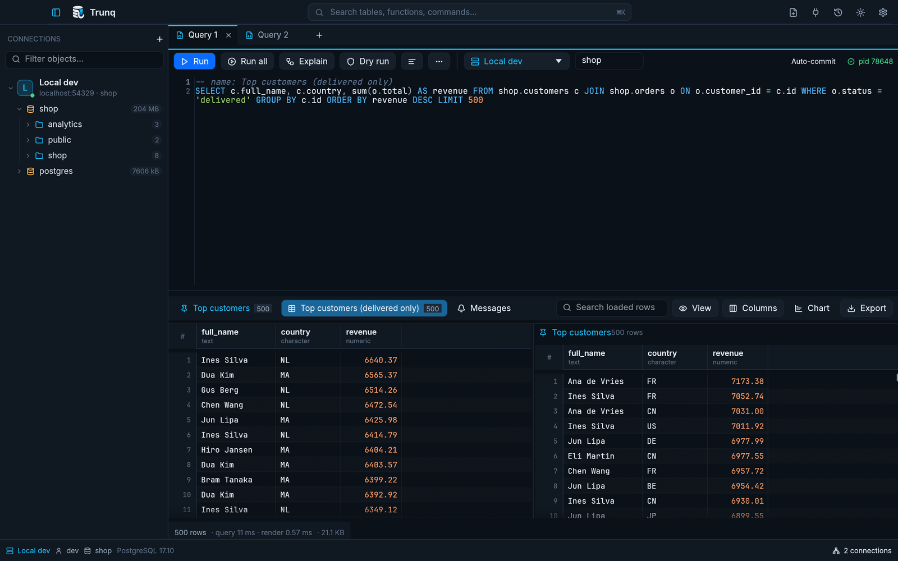

- Results stream through a **server-side cursor**. The first page contains up to 1,000 rows and more load as you scroll, keeping the initial result bounded even for large tables.
- **Virtualised grid**: only visible rows and columns are rendered. Sticky header and row numbers, resizable and auto-fitting columns.
- **Pin query results**: pin a result, run another query and compare the two **side by side**. A new run never overwrites a pinned result.
- **Local search** over the loaded rows with matching cells highlighted, without asking PostgreSQL again.
- **Click to filter**: right-click a value for *Filter by this value*, *Exclude this value*, *Show NULLs*, *Hide NULLs* or *Copy as WHERE*. Filters show as removable chips. In a table view they become a server-side `WHERE`.
- **Column tools**: show and hide columns, **Hide empty columns** (only NULL in the loaded rows), and a **Column finder** (⌘F) that jumps to any column, even in a table with 80 of them.
- **Instant aggregates**: select cells to see COUNT, SUM, AVG, MIN and MAX in the footer.
- **Timestamp switch**: show `timestamptz` values raw, in local time or in UTC.
- **Query timing breakdown**: query time, fetch time and render time are shown separately for every result.
- Local sorting with natural ordering ("file2" before "file10") and precision-preserving numeric comparisons.

### Look closer at your data

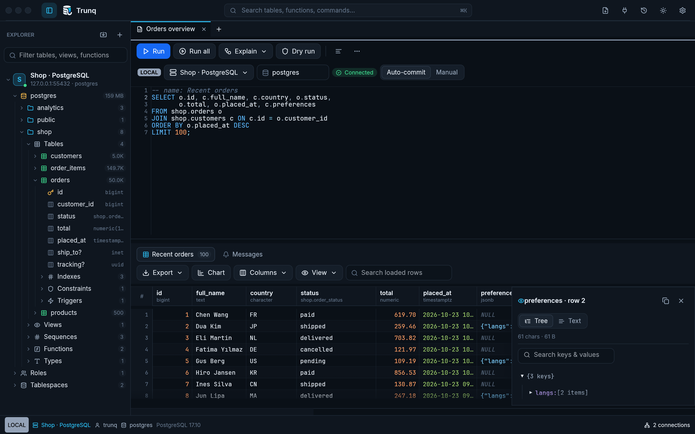

- **JSON tree**: open any JSON or JSONB value as an interactive tree with search. Right-click a node to copy its path (`$.items[2].sku`), the PostgreSQL accessor (`payload->'items'->2->>'sku'`) or the value. Large documents expand lazily, so multi-megabyte values stay fast.
- Large JSON in the grid shows a compact size badge (`{…} 14 KB`) and a pretty preview on hover, so a big document never breaks the layout.
- **Row card view**: look at one record vertically instead of scrolling sideways through 40 columns. Use ← and → to move between rows.

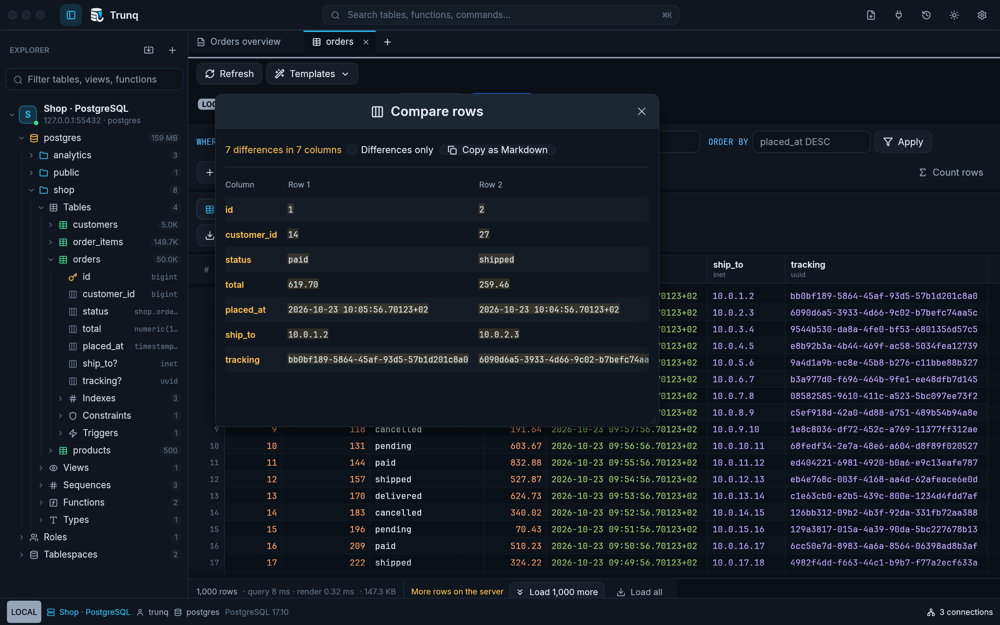

- **Compare rows**: select two to six records and compare them side by side. Trunq highlights only the values that differ, and *Differences only* hides the rest. Ideal when two customers, configurations or orders are almost identical.
- **Foreign key peek**: hover a foreign key such as `customer_id = 42` and the related record appears in a small popup. **⌘-click** opens it. This works in any query result, not only in table views, because PostgreSQL tells Trunq where every result column comes from.
- **Copy as anything**: copy selected records as TSV, CSV, JSON, Markdown, SQL INSERT, SQL UPDATE (keyed by the primary key), SQL WHERE, a TypeScript array or an `IN (...)` list.

### One-click charts

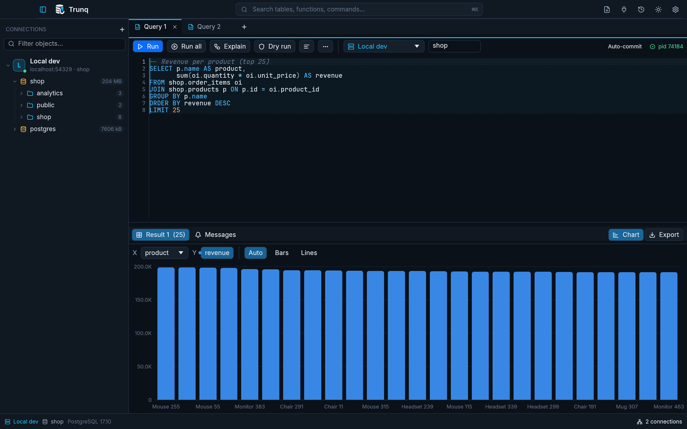

- Turn any result into a bar or line chart. A time or numeric X axis becomes a line, categories become bars.
- A colour-blind-safe palette, hover tooltips, a legend and direct labels. Default series selection favours similar scales; selecting very different scales shows a warning. See [chart controls and limits](workflows.md#make-a-chart-with-meaningful-axes).

### Edit data safely

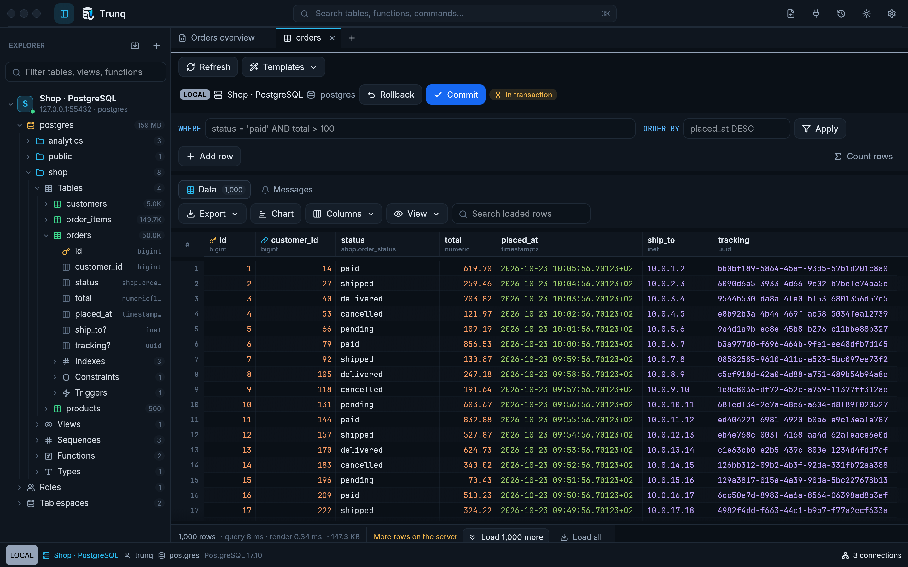

- Double-click a table to browse it with a `WHERE` and `ORDER BY` bar. Key icons mark the primary key, link icons mark foreign keys.
- Edit cells inline, add rows, set NULLs and delete rows. Changed cells are highlighted.
- **Duplicate row** copies a record and leaves out the primary key and identity or generated columns, so the database assigns fresh values.
- **Preview the generated SQL**, then save everything in one transaction.
- **Remember my table**: per table Trunq remembers hidden columns, column widths, filters, sorting and the grid or card view. Open the same table tomorrow and everything is as you left it.

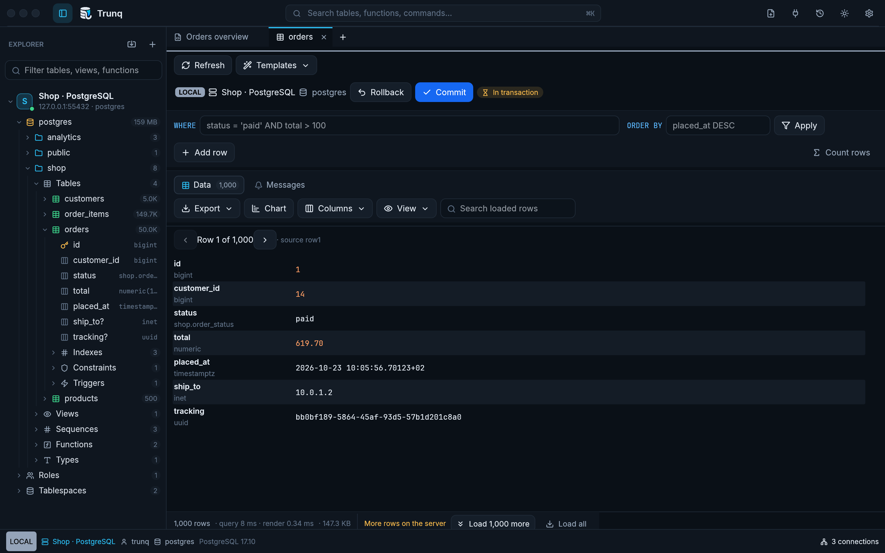

### Export exactly this

Export is explicit about what you get, so you never think you exported a full dataset when only the first rows were in memory:

- **Visible rows**: exactly what you see, with search, filters and sorting applied.
- **Loaded rows**: the rows fetched so far, with a note when more rows exist on the server.
- **Entire result from the server**: runs the query again on a separate connection and streams every row straight to the file. Only a chunk is held in memory, and you can request cancellation.

Formats: CSV, JSON, Markdown, SQL INSERT and TypeScript.

### Safety features other clients do not have

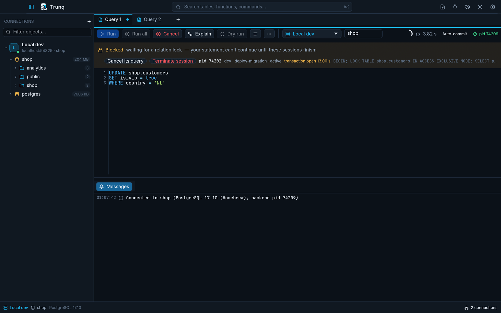

- **Lock detective**: when a query runs longer than 1.5 s Trunq shows what it waits for and *which session blocks it* (user, application, query, transaction age), with one-click *Cancel its query* or *Terminate session*.
- **Live progress** of `CREATE INDEX`, `VACUUM`, `ANALYZE`, `COPY` and `CLUSTER`.
- **Dry run** (⌥⌘⏎): runs an `INSERT`, `UPDATE` or `DELETE` in a transaction, previews returned rows up to the fetch page size and rolls back. See [transaction behaviour and rollback limits](workflows.md#auto-commit-manual-and-failed-transactions).

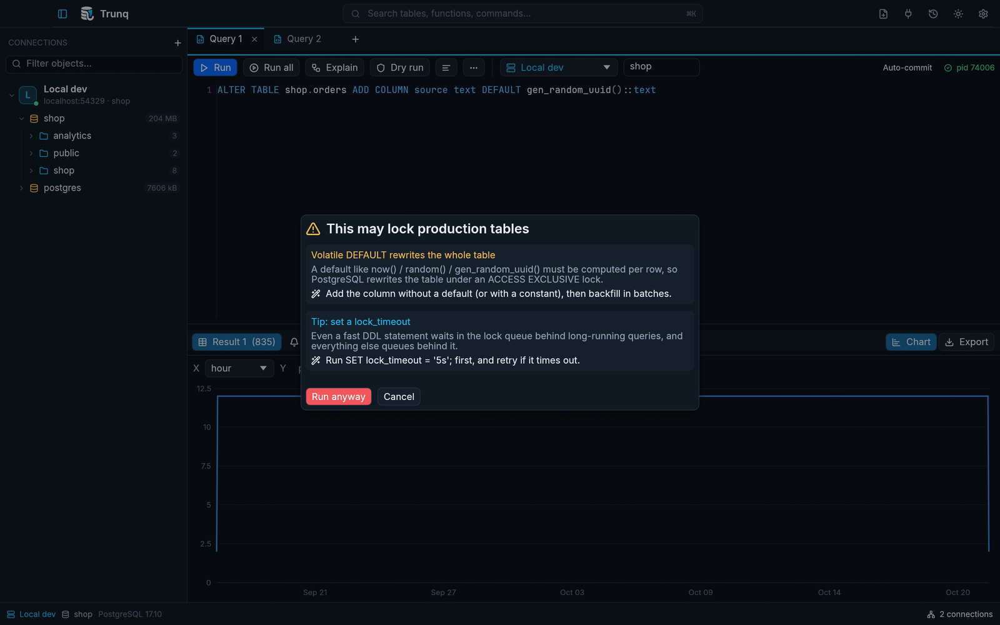

- **Migration linter**: before DDL that would block or rewrite a table (plain `CREATE INDEX`, column type changes, `SET NOT NULL`, foreign keys without `NOT VALID`, volatile defaults, `VACUUM FULL` and more) Trunq explains the risk and the safe alternative, with a one-click *Add CONCURRENTLY*.
- Confirmation for `UPDATE` or `DELETE` without `WHERE`, `DROP` and `TRUNCATE`.
- **Forgotten transaction guard**: a banner appears when a tab holds a transaction, and its locks, for more than a minute.
- **Connection identity**: the status bar always shows the environment, server, user and database. Mark a connection as LOCAL, DEV, TEST, STAGING or PRODUCTION; production is red everywhere, including a strip above the editor.
- Read-only connections and per-connection statement timeouts.

### Health and monitoring

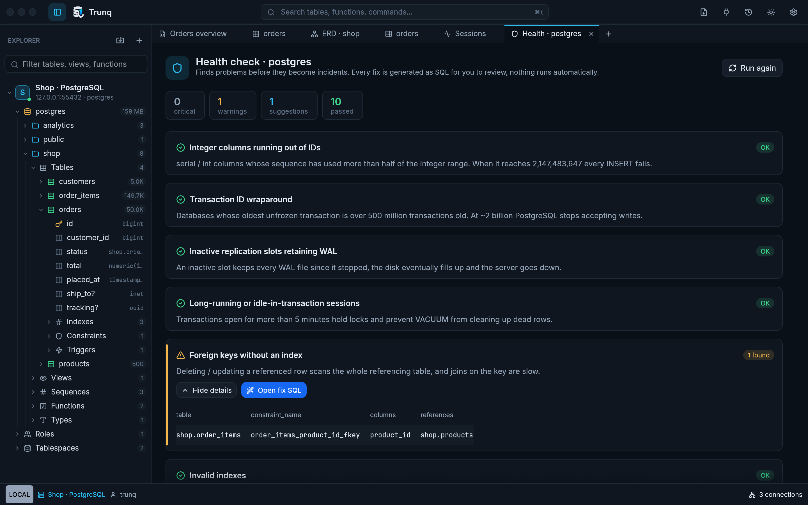

- **Database health check**: finds integer IDs close to overflow, transaction ID wraparound, inactive replication slots filling the disk, foreign keys without an index, invalid, duplicate and unused indexes, bloated or never analyzed tables, long transactions, tables without a primary key and a low cache hit ratio. Every finding comes with fix SQL to review.

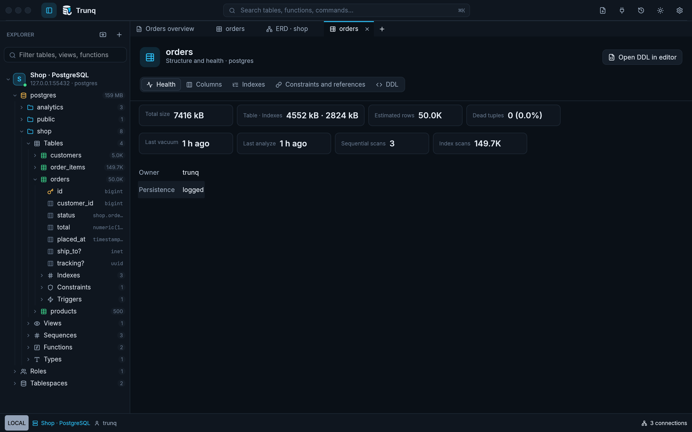

- **Table health and structure**: size of table and indexes, estimated rows, dead tuples, last vacuum and analyze, sequential versus index scans, with tips when something looks wrong. Plus columns, indexes (each with its own DDL), constraints, references in both directions, triggers, partitions, privileges and the full DDL.

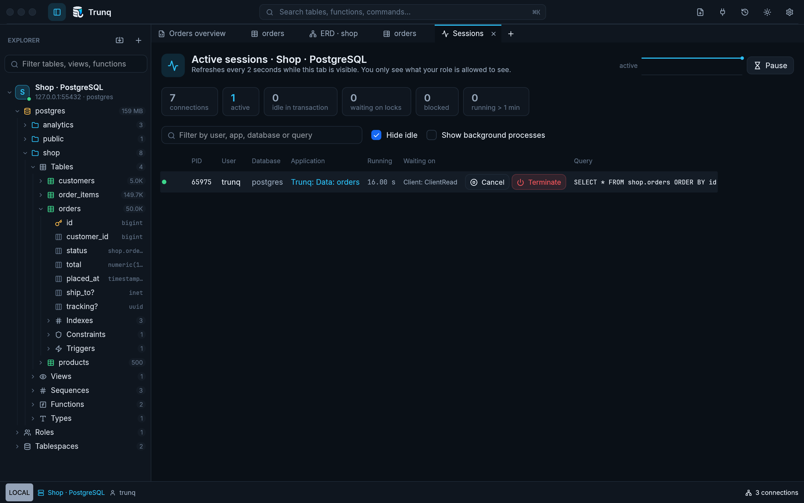

- **Active sessions**: a compact view of active sessions and long-running queries within your privileges, refreshed every two seconds while visible. It shows who is idle in a transaction, waiting on locks or blocked, with cancel and terminate (after a confirmation).
- **EXPLAIN and EXPLAIN ANALYZE** visualiser with per-node time share, loops and row estimate warnings.

### Import CSV by drag and drop

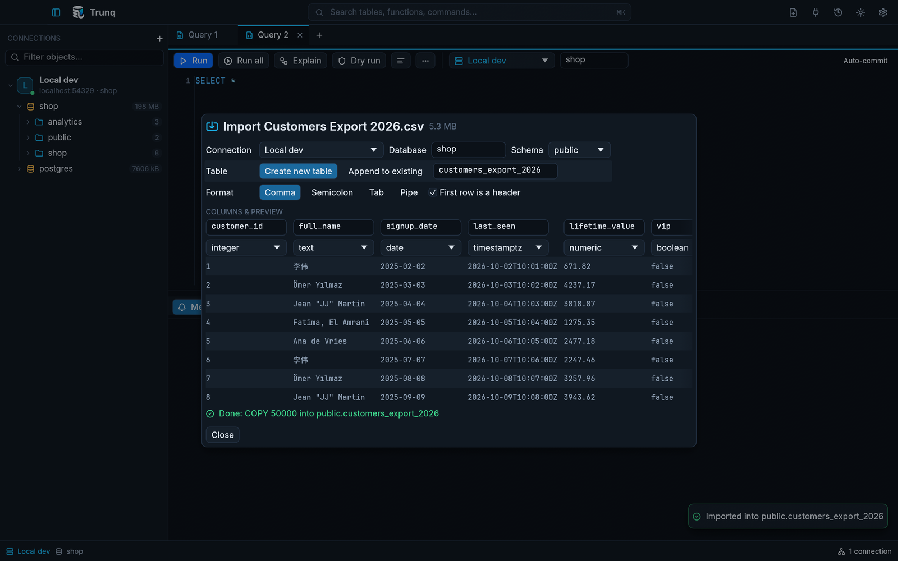

- Drop a CSV or TSV onto the window. Delimiter, header, column names and **types are inferred** (integer, bigint, numeric, boolean, date, timestamptz, uuid, jsonb).
- Create a new table or append to an existing one. The file is streamed through `COPY FROM STDIN` in a single transaction with live progress, the fastest way to load data into PostgreSQL.

### Navigate everything from the keyboard

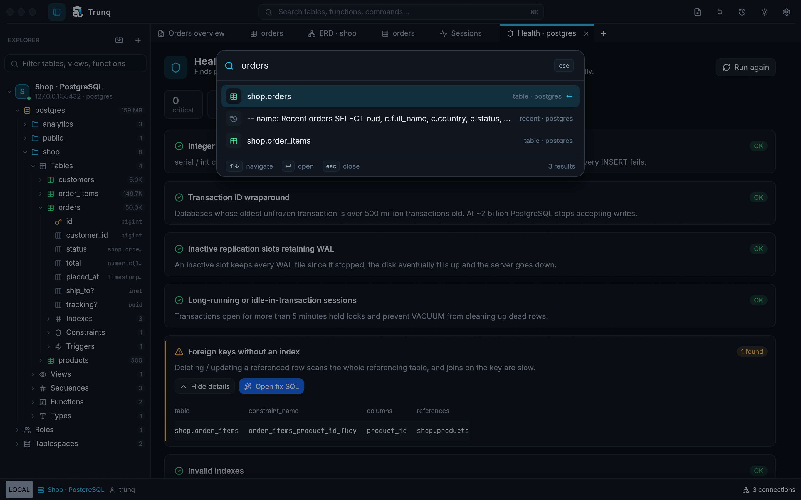

- **Command palette** (⌘K): one search field for tables, views, functions, connections, saved snippets, recent queries and commands such as *Format SQL* or *Switch this tab to another connection*.
- **Object tree** with databases, schemas, tables (expand to columns with types, keys and foreign keys), views, materialized views, sequences, functions and types, with row estimates and sizes.
- **Extension manager**: search every server-provided extension by name/description, choose a version/schema, review optional dependencies and enable/update directly. Read-only/recovery guards and server error reporting are included. [Quick start](extensions.md).
- **Database tools**: extension version/dependency inventory, reviewed create/update templates, pg_cron scheduling/pause/removal, audit/security inspections, foreign-server and replication inventories. Installed extensions, event triggers and publications appear in the tree. [Administration and limits](administration.md).
- **Quick DDL**: view or copy the DDL of a table, view, function, sequence or index from the context menu.
- Generate SELECT, INSERT, UPDATE, DELETE, EXPLAIN and maintenance commands from the context menu.

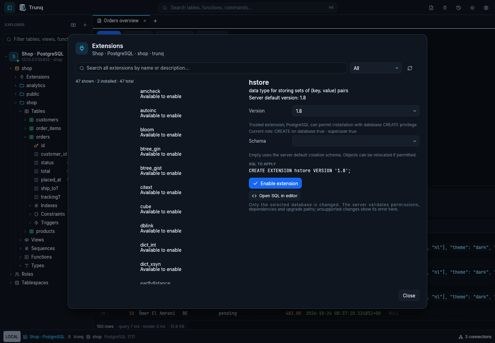

### Connect to anything

- TLS (`disable` up to `verify-full`), SCRAM-SHA-256, MD5 and trust, Unix sockets, `~/.pgpass`, or paste a `postgres://` URL.
- **SSH tunnels** through a bastion or jump host, with agent, key file or password authentication.
- **Microsoft Entra ID** for Azure Database for PostgreSQL (Azure global, **Azure China (21Vianet)** and Azure US Government) through the browser, a device code or the Azure CLI, with automatic hourly token refresh.
- **Token commands** with Azure CLI, AWS RDS and Google Cloud presets, plus arbitrary local helpers; tokens are acquired for new connections. [Provider setup](cloud-authentication.md).
- Per-profile PEM CA bundles and client certificates with PKCS #8 keys; TLS setup has a bounded timeout.
- Passwords, SSH secrets and interactive refresh tokens use the operating system keychain. Service-principal secrets can come from environment variables. Keep secrets out of ordinary saved helper arguments. No telemetry.

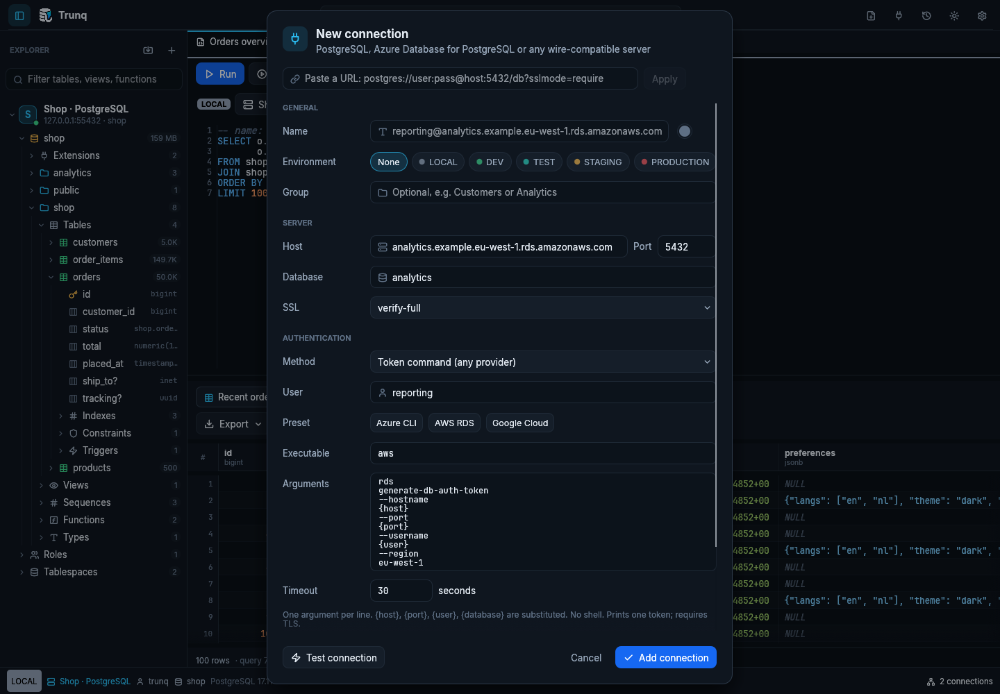

Example profile only; live provider prerequisites are documented in the cloud guide. Native SSH requires Ed25519/ECDSA and supports disabling first-use trust for pinned production hosts. Older stored credentials need [one-time re-entry](production.md#upgrade-and-credential-changes).

### Connection ownership and cleanup

- Every connection belongs to exactly one tab or browser node and is closed when that goes away. A running statement is cancelled first. Idle query tabs disconnect after 15 minutes and reconnect transparently.
- Monitoring, foreign key peeks and the sessions view reuse the existing browser connection instead of opening new ones. Health checks, exports and imports use a short-lived connection that closes as soon as they finish.
- The status bar shows the live connection count. Click it to see every connection (purpose, PID, age) and close any of them.
- Each connection sets `application_name` (`Trunq: Query 3`, `Trunq: Object browser` and so on) so you can find it in `pg_stat_activity`. Background metadata connections use `lock_timeout` and `statement_timeout` to limit waits during migrations.
- TCP keep-alive detects dead networks. Channels using the same SSH configuration share one SSH session, released after the final channel closes. Everything closes cleanly on exit.

## Fast by design

- **Native and GPU rendered** with egui and wgpu. A single binary of about 20 MB, no runtime to start.
- **Text protocol, zero decoding**: Trunq talks to PostgreSQL directly and copies each row from the socket into one compact buffer. A million rows are a few allocations, not millions of strings.
- **Server-side cursors**: only the rows you look at are fetched, and the next page loads while you scroll.
- **Virtualised grid**: only visible rows and columns are laid out. Text layout is cached between frames.
- **Never blocks the UI**: every network call runs on a background runtime. The interface keeps drawing even while a query waits on a lock.
- **Stable scrolling**: hard grid boundaries prevent elastic trackpad scrolling from reversing at page edges, while sticky headers and keyboard navigation keep the same scroll position.
- **Cached search and aggregates**: empty search results stay cached; sorting, filtering, hide-empty columns and selection aggregates track edits and replacement results. Selected-cell aggregates are calculated once per change.
- **Measured**: every result shows its query, fetch and render time, so you can see where the milliseconds go.

### Explore relationships and database metadata

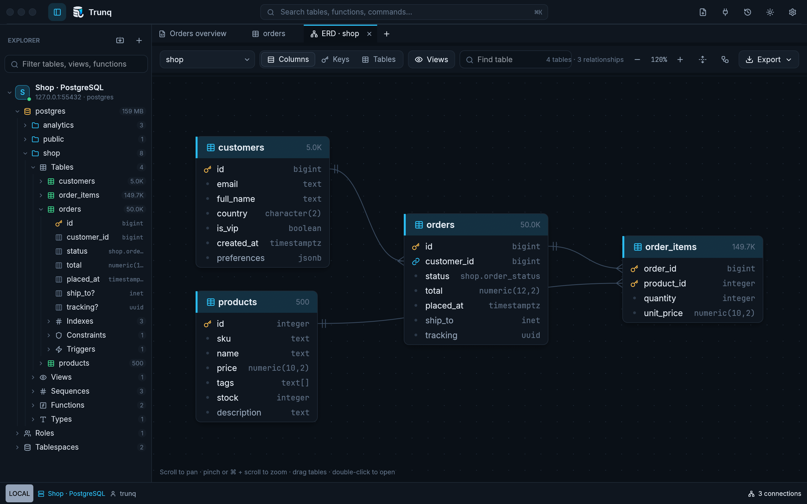

- Right-click a **database**, **schema** or **table** → **ER diagram**, or search for it with **⌘K**. Pan, zoom, move tables, inspect keys and export SVG or Mermaid using the existing diagram tools.
- Expand a table to inspect **indexes**, **constraints**, **triggers**, **row-level security** and **policies**, with details on hover.
- Expand the server's **Roles** and **Tablespaces** groups; roles show attributes, memberships and copyable DDL.
- Right-click a database → **Slow queries (pg_stat_statements)** for an editable query showing execution time and buffer counters. Requires the extension; Trunq does not install it automatically.

Light theme and a compact data viewer

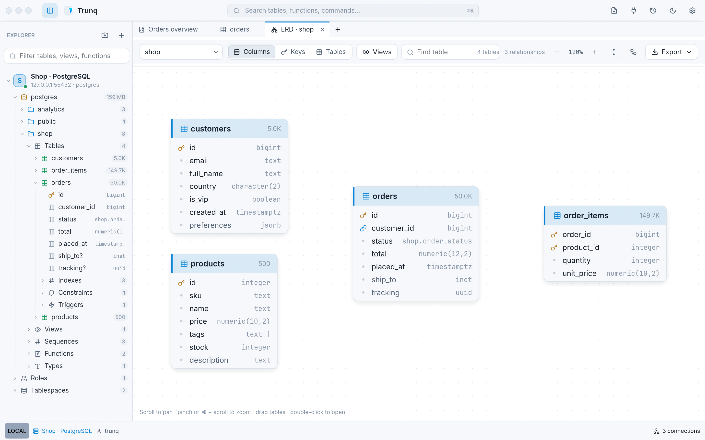
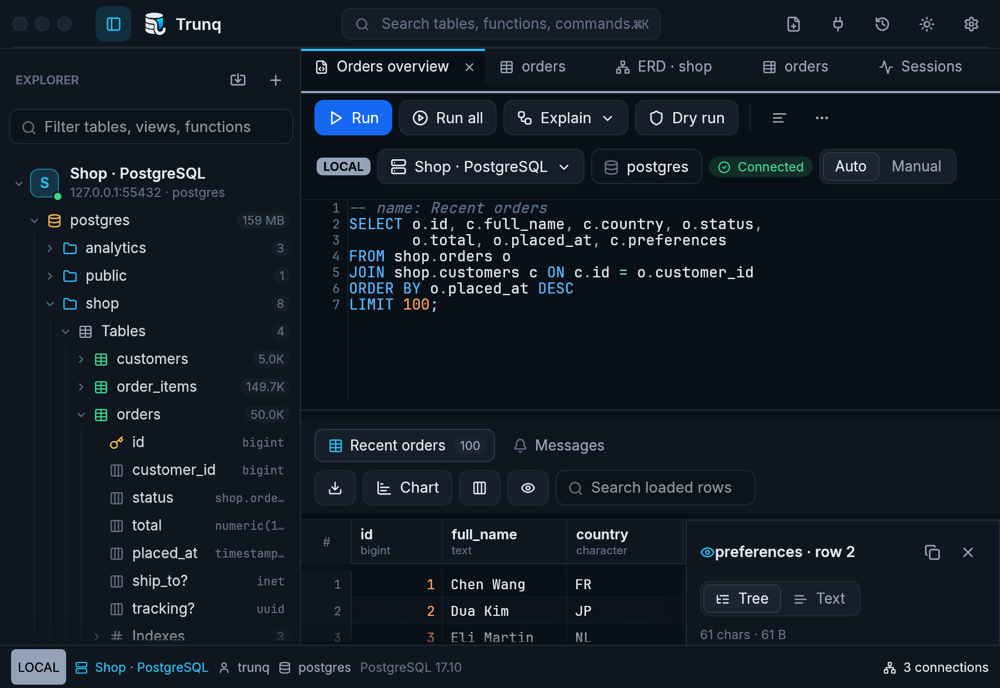

### Grants and access tracing

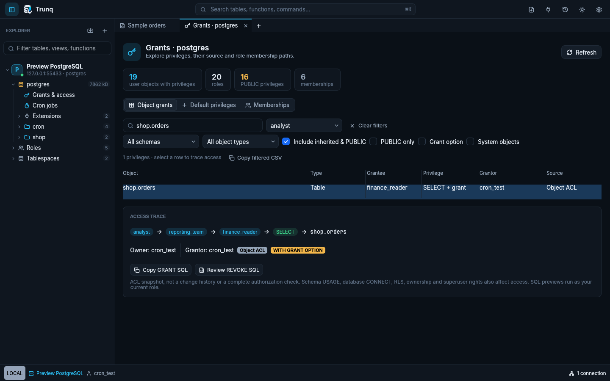

Open **Grants & access** under a database in the sidebar, its context menu or the command palette. A table or schema context menu opens a prefilled search.

- Browse table, view, materialized view, foreign table, column, sequence, schema, routine, type, current database, language, foreign server / wrapper, tablespace and large-object ACLs. Catalog queries include grants that `information_schema.role_table_grants` can hide from the connected role.
- Filter by role, schema, object type, grant option, PUBLIC access and text. System schemas are hidden initially. Copy the filtered inventory as CSV.
- Select a privilege to see its owner, original grantor, recipient and a role-membership path. Role filters can include indirect memberships and PUBLIC. `NO INHERIT` paths remain visible with an explicit warning; they are not reported as automatic access. **Memberships** shows direct role edges, grantors, ADMIN, INHERIT and SET ROLE options, including PostgreSQL 16+ per-membership options.
- **Default privileges** lists future-object ACL rules separately from existing-object grants and built-in ACL defaults. Global and per-schema rules combine.
- Copy a GRANT statement or open a REVOKE statement for review. Changes run only when you execute the SQL yourself. REVOKE does not add CASCADE. RLS-enabled objects link to their policies.

The **Privilege** column shows the exact PostgreSQL right, one per row:

| Privilege | Meaning |
|---|---|
| `SELECT` | Read rows or values |
| `INSERT`, `UPDATE`, `DELETE` | Add, change or remove rows |
| `TRUNCATE`, `REFERENCES`, `TRIGGER` | Empty a table, reference it with a foreign key, or create triggers |
| `USAGE`, `CREATE` | Use or create objects, depending on the selected object type |
| `EXECUTE` | Call a function or procedure |
| `CONNECT`, `TEMPORARY` | Connect to a database or create temporary objects |
| `MAINTAIN` | Table maintenance on PostgreSQL versions that support this privilege |

`GRANT ALL` is stored by PostgreSQL as the individual privileges available for that object type and server version. The inspector expands them into their concrete rows; it cannot tell whether they originally came from one ALL statement or several individual GRANT statements. **WITH GRANT OPTION** means the recipient can grant that privilege onward; it does not mean ALL. Use the search box for a privilege such as `SELECT` or `INSERT`, and select the role/object to inspect its scope and source.

This is a refreshable snapshot of the selected database, with shared tablespace ACLs and cluster role memberships. It does not record historical changes or claim complete effective authorization: schema USAGE, database CONNECT, RLS, object ownership, superuser privileges and predefined roles also affect access. Owners retain implicit management rights even when their ordinary ACL privileges have been revoked. Inspect each database separately.

### Extension UI

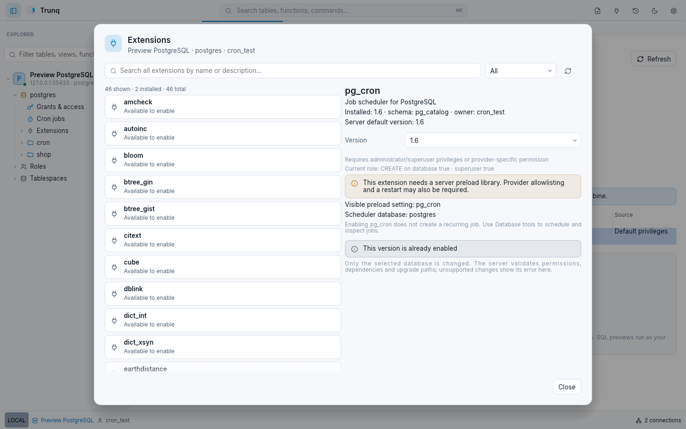

The [extension manager](extensions.md) remains the single entry point for available versions, dependencies, provider requirements and explicit install/update actions. Its virtualized extension list now uses a shared two-line choice component with consistent selection, icons and truncation. Read-only and recovery safeguards remain in effect.

### Scheduled jobs (pg_cron)

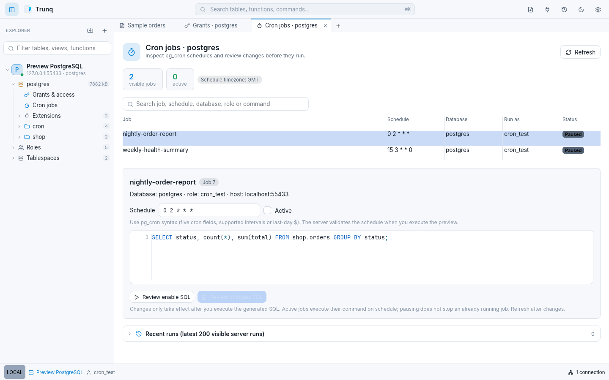

Open **Cron jobs** under a database or from its context menu / command palette. Trunq detects pg_cron and explains when it is absent, installed in another database, or unavailable to your role. It does not install the extension or modify server configuration.

The inventory shows job names, schedules, active / paused status, target database, execution role and command, plus the server's schedule timezone when visible. Select a job to edit its schedule and SQL using the existing SQL editor. **Review pause SQL**, **Review enable SQL** and **Review changes SQL** open `cron.alter_job` statements in a query tab; you execute them explicitly. Only changed fields are supplied, preserving the job's target database and run-as role. Read-only connections disable edits. Older extension versions without `cron.alter_job` remain browseable.

The run-history section uses the latest 200 runs visible to your role and identifies when history is unavailable. PostgreSQL permissions and pg_cron's row security remain in effect. Pausing a job prevents future scheduled starts; it does not cancel an already running job. Refresh after executing changes. pg_cron validates schedule syntax, including supported second intervals and last-day `$` syntax.

GitHub Actions schedules are separate: the daily nightly build is configured by the `schedule` entry in [release.yml](../.github/workflows/release.yml). Maintainers can disable or enable that workflow in GitHub's Actions page, or change its cron expression in a reviewed pull request. The client job screen manages PostgreSQL pg_cron metadata.
