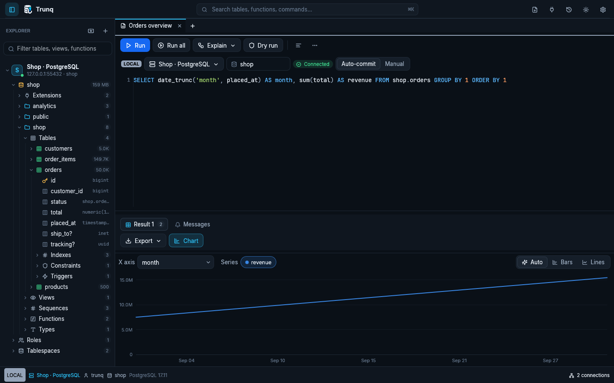

# Performance checks

Measured on 23 October 2026 on an Intel macOS 13.7.8 development machine, Rust release profile (`opt-level=3`, thin LTO), PostgreSQL 17.10 over loopback. Compilation and container builds were also running, so these are development observations rather than controlled rankings. Repeat on your target hardware with other workloads before drawing comparisons.

| Workload | Observed result | What it measures |
|---|---:|---|
| First local search with no matches over 1,000,000 one-column rows | 42.631 ms | Client scan, excluding construction of the fixture |
| 1,000 repeat view refreshes for that unchanged empty search | 0.467 ms total | Cache lookup and display-column refresh; no repeated million-row scan |
| Fetch and retain 1,000,000 rows, 5 columns, 50,000 rows per page | 2.890 s; 345,976 rows/s | Server execution, loopback protocol transfer and compact result accumulation |
| Retained cell payload plus offsets for that result | 113,978,440 bytes | `ResultSet::byte_size()`, excluding allocated spare capacity, other application memory and GPU memory |
| Empty-workspace startup to first presented frame | 1,157.1 ms | From entry into `main`, reported on the second frame; excludes OS process-loader time |

The fetch fixture is `analytics.events` from [the sample database](../dev/sample.sql). It contains a timestamp, event kind, UUID and JSONB alongside its identifier. Data generation is separate from the timed fetch. These numbers do not measure scroll FPS, cold disk performance, remote network latency or memory RSS, and do not establish that Trunq is the fastest PostgreSQL client.

## Reproduce

Use a disposable database: `dev/sample.sql` drops and recreates its sample schemas.

```sh
psql "$TRUNQ_TEST_DATABASE_URL" -v ON_ERROR_STOP=1 -f dev/sample.sql
cargo test --release --locked bench_empty_filter_million -- --ignored --nocapture
cargo test --release --locked bench_fetch_million -- --ignored --nocapture
cargo build --release --locked
TRUNQ_CONFIG_DIR=/tmp/trunq-startup TRUNQ_BENCH=startup ./target/release/trunq
```

Set `TRUNQ_TEST_DATABASE_URL` before running the fetch benchmark. Its default SQL is `SELECT * FROM analytics.events LIMIT 1000000`; override it with `TRUNQ_BENCH_SQL` to compare a different workload. Unconfigured live tests return without contacting a server, so a successful test command without that variable does not demonstrate database compatibility.

## Scroll stability

A headless egui regression drives a 5,000-row grid, appends pages up to 8,000 rows and then sends decaying trackpad momentum. Before the fix, a downward gesture reversed from 183,713.98 to 183,712.14 UI points as elastic overscroll sprung back. The grid now uses hard scroll boundaries, and that regression remains monotonic. Keyboard navigation loads the correctly salted scroll state, and headers use the offset painted by the body.

```sh
cargo test --locked scrolling_loaded_pages_does_not_reverse_direction
```

## Changes that remove repeated work

- Empty search results are valid cached results. Previously, an empty view triggered another full scan on every frame.
- Result identity participates in view invalidation, so replacing data with the same shape and byte length cannot reuse an outdated search or sort.
- Numeric sorting preserves bigint/numeric precision when floating-point keys tie and orders NaN consistently.
- Pending cell changes participate in filtering, sorting and hide-empty detection. Editing or discarding invalidates the appropriate view.
- Selection aggregates are cached until the selection, result, column view or edits change. Their calculation walks selected row/column slices without copying them into new vectors each frame. Non-finite values do not poison totals.
- Diagram and browser metadata reuse the existing catalog. No extra polling is introduced for these features.

Rendering only visible cells does not make loading an entire result free. **Load all** intentionally retains rows; use **Export → Entire result from the server** for a bounded-memory file export. A suspended portal keeps a PostgreSQL transaction open until it is exhausted or closed; Trunq now reports that state.

## Chart preparation cache (25 October 2026)

Measured at source checkpoint `f907238` in the Linux cloud environment, Rust 1.95 release profile, with three visible vCPUs reporting Intel Xeon Platinum 8573C. Other development checks and GUI sessions were running. These are workload observations, not controlled client rankings or a scroll-FPS measurement. The extension-manager follow-up does not change the chart algorithm.

| Workload | Observed result |
|---|---:|
| Prepare 1,000,000 rows with reversed numeric X and one finite Y series, then decimate for a 1,000-point-wide plot | 62.630 ms |
| 1,000 unchanged data/geometry preparation requests after that | 0.053 ms total |
| Retained decimated points for that series/width | 2,002 |

The fixture uses X values from 1,000,000 down to 1 and Y values `row_index % 997`. Fixture construction is excluded. Preparation includes parsing, sorting X, parsing Y, finding the value range and building pixel-bucket extrema. The cached measurement is cache validation; it excludes drawing, layout, hover text, GPU submission, database execution and network transfer. It must not be interpreted as a complete frame time.

Previously this preparation happened again during every chart frame. The client now reuses parsed/sorted data until the result identity, row payload, axes, series, type categories or line/bar mode changes. Width changes rebuild decimation without sorting/parsing again. Cached painting walks the decimated points; nearest-X hover lookup uses the sorted values. Cache invalidation tests cover appends, equal-sized result replacements, axes and kind changes.

This trades memory for repeated work. On a 64-bit target, a million-row line chart retains roughly 16 MB of X/source-row pairs plus 8 MB per selected Y series, excluding capacity, the original result and drawing geometry. The first preparation remains proportional to the data volume, and resize-driven decimation still scans the loaded data. Bars retain only their displayed subset.

```sh
cargo test --release --locked bench_chart_million -- --ignored --nocapture
```

The regression suite also checks timestamp offsets, rejects NaN/Infinity coordinates and preserves the source order of bucket extrema and the actual line endpoints.

## Resource bounds alongside performance

Protocol messages and retained diagnostics now have explicit [production resource limits](production.md#bound-resource-use-and-recover-cleanly). They reduce memory exhaustion from malformed frames or notice/notification floods; they do not cap all loaded rows or turn chart decimation into streaming storage. History startup streams only its retained window, and duplicate queries trigger disk compaction. SSH transport caches release their last handle when the final channel closes rather than accumulating idle authenticated sessions.



## 25 October 2026: grants inspector and query-path check

The same Linux cloud environment, Rust 1.95 debug profile and loopback PostgreSQL 17 were used for these checks. They are development observations, with normal scheduling variance, rather than release-mode or cross-platform guarantees.

| Workload | Observation |
|---|---|
| Existing million-row empty-filter benchmark at baseline `6957b54` | First scan 72.160 ms; 1,000 cached refreshes 0.627 ms total |
| Same benchmark after the inspector changes | First scan 69.405 ms; 1,000 cached refreshes 0.626 ms total |
| 100,000 grants, 100 actual headless inspector frames | 2.125 ms per cached frame on average |
| Same grants with an unchanged empty search | 0.627 ms per cached frame on average |
| Grant parsing, facets, counts and prepared search text | 276.426 ms once for the 100,000-row fixture; performed off the UI thread in the application |
| Existing million-row / five-column fetch | 1.243 s; 804,347 rows/s; 113,978,440 bytes of retained cells and offsets |

The query grid implementation did not change. These final measurements include the integration with `9bf1377` and ran after native screenshot capture finished to avoid concurrent software-rendering load. New inspectors fetch only when opened or explicitly refreshed, release their database connections after completion, and do not add recurring server polling. Grant facets and counts are prepared once; unchanged filters reuse their row indices, including empty results, and role routes are cached. Tables render only visible rows. Opening an inspector in a background tab still completes its snapshot and releases the connection.

Reproduce the grant workload with `cargo test --locked bench_grants_virtualized_frames -- --ignored --nocapture`. The two existing benchmark commands above exercise the query grid and protocol fetch. The baseline was an archive of the recorded commit built with the same toolchain, not a different machine or release profile.

## 26 October 2026: grouped grants view

On macOS with Rust 1.99.1 in the debug profile, the actual headless grants inspector rendered 100 cached frames of a 100,000-record inventory at **1.877 ms per frame** on average; an unchanged empty filter averaged **0.612 ms**. This is a local development observation, not a cross-machine comparison or a scroll-FPS guarantee. The grouped rows and membership lists render only the visible rows and rebuild their grouping/filter caches when the filters change.

The same workload remains available through `cargo test --locked bench_grants_virtualized_frames -- --ignored --nocapture`. The presentation keeps original grant records separate for export and per-privilege SQL even when multiple permissions share one visible row.
