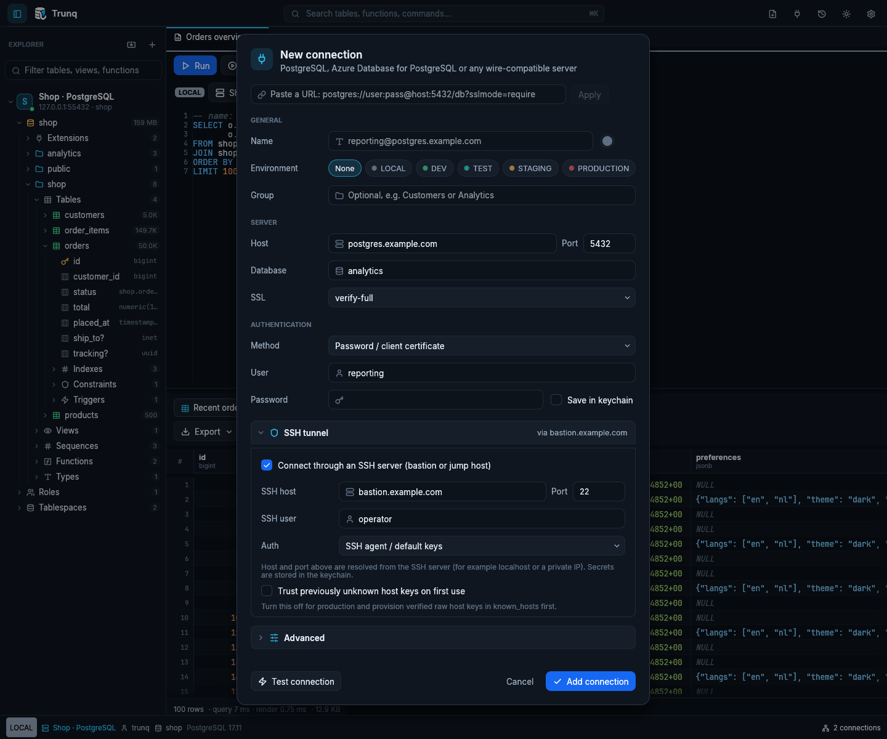

# Using Trunq with production databases

[Documentation](README.md) · [Security policy](../SECURITY.md) · [Review findings](security-review.md)

Trunq is a desktop database client. Its warnings, environment labels and read-only defaults help operators, while PostgreSQL permissions and your network/security policy enforce access. Test a new build against staging before connecting it to production. Nightlies contain unreleased changes; retain the exact source/build identity when reporting a problem.

## Prepare the connection

1. Use a dedicated login with the minimum database/schema/table privileges needed. Use a separate, short-lived administrative identity for extension installation or schema changes. Avoid routine superuser access.
2. Set **SSL → verify-full**, keep the original database hostname and install the appropriate CA bundle. The ordinary password-profile default `prefer` permits plaintext when the server declines TLS; `require` encrypts without authenticating the server.
3. For SSH, provision verified raw Ed25519/ECDSA host keys and turn **Trust previously unknown host keys on first use** off. Verify fingerprints through a trusted channel. `ssh-keyscan` alone does not establish trust. Host certificates/CA policies and RSA keys are unsupported in the native tunnel.
4. Set a recognizable profile name and **Production** environment. Enable read-only defaults for inspection work; enforce restricted grants on the server as well. A role able to change its session mode can override a read-only default.
5. Choose a statement timeout appropriate for the workload and connection limits appropriate for separate query/browser/export sessions. Check **Test connection**, then verify `current_user`, `current_database()` and the actual server before changing data.

The screenshot is an illustrative profile in the real connection dialog. It does not represent a connection to that example bastion. See [connections](connections.md) and [cloud authentication](cloud-authentication.md) for password precedence, identity selection and TLS file formats.

## Upgrade and credential changes

Database and SSH keychain names now include a fingerprint of the relevant connection target as well as the profile ID. Changing host, port, user, default database, authentication configuration or enabled bastion prevents reuse of the old database credential. Changing the SSH configuration also invalidates its typed/saved SSH secret. In-memory passwords are cleared on target changes; already-open database sessions retain their original identity until disconnected.

**Re-enter saved database passwords and SSH secrets once after upgrading from profile-ID-only storage.** Trunq intentionally does not guess which endpoint owns an older secret. Legacy keychain entries remain until profile removal or manual keychain cleanup; changing a target can also leave its previous scoped entry behind. Deleting a profile removes its current scoped entries and legacy ID entries, rather than enumerating every historical target. Interactive Entra cache migration can require another sign-in too.

Native SSH now excludes the RSA backend because its dependency has an unresolved timing advisory. Use an Ed25519/ECDSA user key and a compatible bastion host key. Existing RSA-only configurations need an administrator-coordinated key change; changing a pinned host key still requires fingerprint verification. See [the dependency findings](security-review.md#dependency-audit).

## Protect local data

Configuration, snippets, editor SQL, query history and exports can contain sensitive business data or SQL literals. They are not encrypted by Trunq. Use a protected OS account, disk encryption and appropriate backup controls. On Unix, new workspace directories use `0700`; configuration/history and learned host-key writes use `0600`. Existing custom directories keep their permissions. Windows uses the containing directory's ACLs. Do not share a writable workspace between untrusted accounts or concurrent instances.

Config saves and history compaction use new private temporary files beside the destination and atomic replacement. Unix append writes reject final-component symlinks/nonregular files. These controls do not make an attacker-controlled parent directory safe. Password files with group/other access are ignored on Unix; use `chmod 600`.

History retains at most 5,000 entries in memory. Periodic disk compaction follows every 501 appends, including consecutive duplicate queries, so the on-disk log can temporarily contain roughly 500 more entries than the retained history. **Query history → Clear** removes that local log, not open editor text, snippets, backups or server logs. See [workspace backup/reset](settings.md).

## Bound resource use and recover cleanly

Paged queries keep server portals/snapshots alive until completion or closure. Finish or close unused results and transactions. **Load all**, pinned results and charts can still consume substantial RAM; per-message bounds do not cap the total result. Use a streaming entire-result export for large downloads and limit very large fields on the server.

The protocol reader rejects an individual server frame above 256 MiB before accepting its announced body; notice/error/notification/parameter-status frames have a 1 MiB bound. Pending notices and notifications are limited separately to 1,024 items and 4 MiB of retained text, with a truncation warning for overflow. These queues are not durable event delivery. Oversized-message errors require closing/reconnecting the affected session, then changing the query; they are not transparent retries.

SSH channels share a session only for the same tunnel configuration. The cache holds weak references and releases the transport after the final channel closes. Query cancellation is a separate PostgreSQL request; verify the result before retrying a write after a lost network connection. A client timeout or disconnect alone cannot establish whether the server committed a statement.

## Extensions, schedules and audit evidence

Review extension SQL, dependencies and update paths, take an appropriate backup and test the intended version in staging. Trusted extension does not mean harmless application code. Provider packages, allowlists, preload settings and restarts require separate operational changes. Schedule jobs under their intended owner, monitor failures and remove test schedules. [Extension manager](extensions.md) · [pg_cron and pgAudit](administration.md).

Use PostgreSQL/pgAudit and cloud control-plane logs with independent retention, access restrictions and alerts. Run a representative action and confirm its arrival at the final log destination. A settings query or an editable local history file cannot demonstrate complete auditing. Avoid broad logging of query parameters if it would expose secrets.

## Release checks and remaining limits

Run the [documented checks](development.md), dependency audit and staging smoke flow for your OS, server, TLS policy and identity provider. Keep a rollback build and workspace backup. [The validation record](validation.md) distinguishes real fixtures from tests that return early without credentials.

The current dependency audit has no reported vulnerable packages after remediation, but four upstream maintenance advisories remain. Actual Azure/AWS/Google identities, OS keychains and provider-specific restart/log delivery require deployment-specific checks. This review does not establish absence of all vulnerabilities or provide a production certification.
